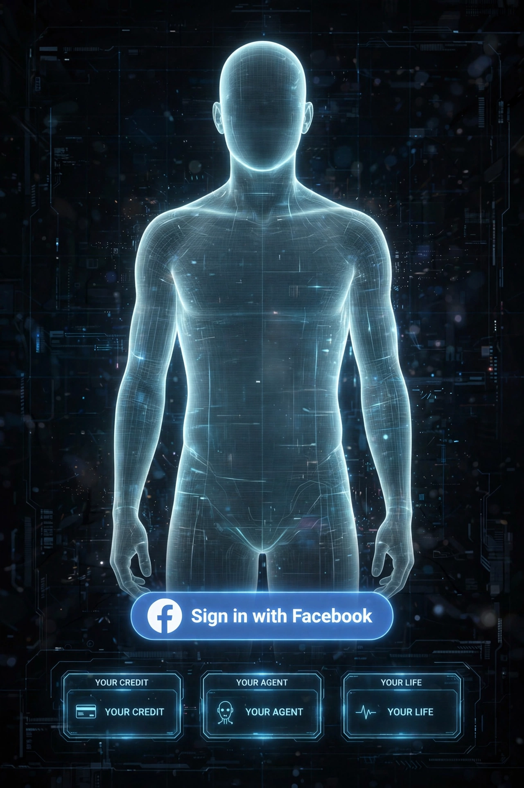

# One button. Your agent.

Mark didn't build an app. He built digital identity — the profile
was the passport, and "Sign in with Facebook" was the border gate
the whole internet agreed to use.

We build on the same gate, pointed the other way:

1. **Sign in** — identity verified at the door. The profile is the
   person; the person is the principal.
2. **Your agent wakes** — grounded on YOUR data: your reports, your
   records, your ledger. Every action it takes is sealed where you
   can read it.
3. **Modules, in order:**
   - **Your Credit** — this dispute engine: conformance audit,
     evidence gate, escalation rounds, generated letters, client
     book. One flat subscription, $97/month.
   - **Your Life** — the ledger of everything else, same verdict
     discipline, wider book.

The face on the poster is blank on purpose. The twin was never
"be me." It's a shell — anyone signs in, anyone steps in, anyone
gets their own.

They classify everybody else's data. We start with yours.
